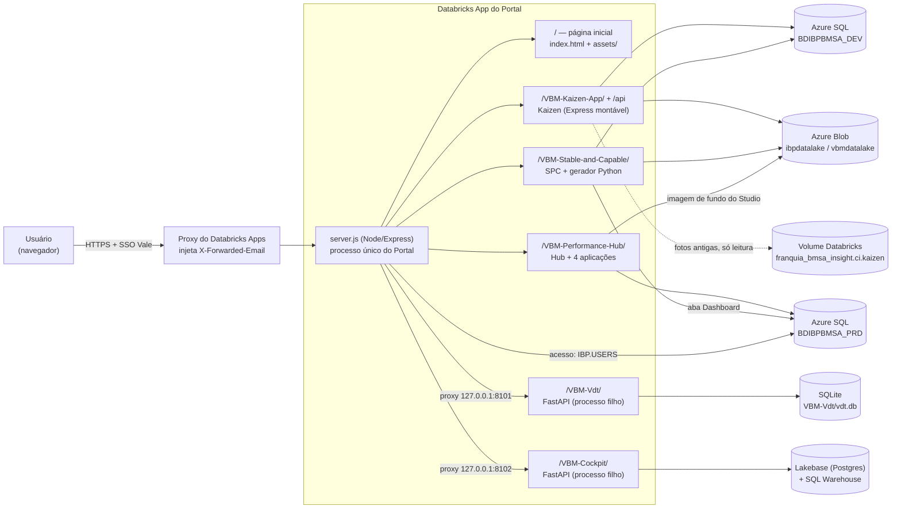
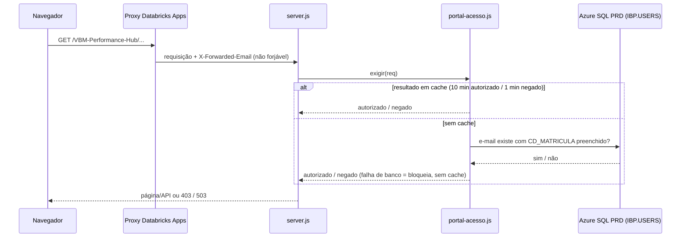
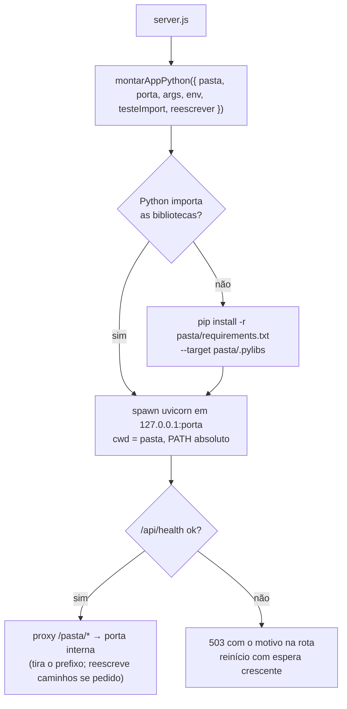

# Arquitetura do Portal PCI e das aplicações

Portal de aplicações de **Performance & Continuous Improvement (PCI)** da Vale Base Metals.
Este documento descreve como o Portal está montado hoje: hospedagem, roteamento, acesso,
bancos, armazenamento e cada aplicação. Para detalhes de uma aplicação, siga o link do
documento dela no fim de cada seção, ou a documentação técnica por projeto em
[`projetos/`](projetos/README.md).

> Situação de referência: `main` em novembro de 2026.

## 1. Visão geral

O Portal é **um único Databricks App** com **um único processo Node.js** (`server.js` da raiz,
Express 5). Ele não tem regra de negócio: entrega a página inicial e **monta cada aplicação
na própria pasta**. Cada aplicação é dona dos seus arquivos, da sua API e da sua conexão com
o banco.



| Camada | Tecnologia |
|---|---|
| Hospedagem | Databricks Apps (um app, um processo; porta em `DATABRICKS_APP_PORT`) |
| Servidor | Node.js + Express 5, `helmet`, `compression`, `mssql` (driver Tedious, 100% JS), `multer`, `exceljs` |
| Aplicações Python | FastAPI/uvicorn como processos filhos (VDT, Cockpit) e scripts Python chamados pelo Node (Stable & Capable) |
| Front-end | HTML/CSS/JS sem framework nas aplicações Node; React (Cockpit) e build estático (VDT) nas Python |
| Banco principal | Azure SQL Database `rdb-ibp-bmsa-prd.database.windows.net` (bases DEV e PRD) |
| Arquivos | Azure Blob Storage (`ibpdatalake`, container `vbmdatalake`) |
| Identidade | SSO do Databricks Apps → cabeçalho `X-Forwarded-Email` |

## 2. Estrutura do repositório

```
pci-portal/
├── server.js               ← processo único: monta tudo (ver §3)
├── portal-acesso.js        ← controle de acesso (IBP.USERS com CD_MATRICULA)
├── apps-python.js          ← sobe e encaminha as aplicações Python (VDT, Cockpit)
├── app.yaml                ← configuração do Databricks App (variáveis e resources)
├── package.json            ← dependências Node do Portal inteiro
├── requirements.txt        ← bibliotecas Python de todas as aplicações
├── index.html, assets/     ← página inicial do Portal
├── VBM-Kaizen-App-DEV/     ← Kaizen (pasta ativa definida por KAIZEN_PASTA)
├── VBM-Kaizen-App-PROD/    ← Kaizen, versão de produção
├── VBM-Performance-Hub/    ← Hub + VBM-Performance-Studio, COO, COO Historical, Health of the Business, Lean Six Sigma
├── VBM-Stable-and-Capable/ ← SPC: PDFs, importação do PCI Master e dashboard
├── VBM-Vdt/                ← Value Driver Tree (Python)
├── VBM-Cockpit/            ← Strategic Cockpit (Python + React)
└── .claude/skills/         ← skills do projeto (setup-dashboards, ajuste-responsividade, otimizacao-da-aplicacao)
```

**Nova aplicação = nova pasta + uma linha de montagem no `server.js`** (ou, dentro do Hub, o
nome da pasta na lista `APLICACOES` de `VBM-Performance-Hub/portal.js`).

## 3. Roteamento (`server.js`)

A ordem de registro importa: o controle de acesso entra **antes** das rotas que ele protege, e
a API de cada aplicação entra **antes** do `express.static` da pasta dela.

| Ordem | Caminho | Quem atende | Acesso |
|---|---|---|---|
| 1 | `/api/*` e `/VBM-Kaizen-App/*` | `kaizen.app` (Express do Kaizen) | aberto, validação própria |
| 2 | `/admin.html`, `/aprovacao.html`, … | redirecionamento 302 para `/VBM-Kaizen-App/...` (links antigos) | — |
| 3 | `/portal/acesso` | status do acesso do usuário | — |
| 4 | `/VBM-Performance-Hub/*` | `VBM-Performance-Hub/portal.js` + estáticos | **IBP.USERS** |
| 5 | `/VBM-Stable-and-Capable/*` | `VBM-Stable-and-Capable/portal.js` + estáticos | **IBP.USERS** |
| 6 | `/VBM-Vdt/*` | proxy para `127.0.0.1:8101` | aberto |
| 7 | `/VBM-Cockpit/*` | proxy para `127.0.0.1:8102` | aberto |
| 8 | `/assets/*`, `/`, `/index.html` | página inicial | **IBP.USERS** (sem acesso, a página sai sem os cards) |

Redirecionamentos de compatibilidade: `/Performance-Hub/*` → `/VBM-Performance-Hub/*` e
`/VBM-Performance-Studio/*` → `/VBM-Performance-Hub/VBM-Performance-Studio/*`.

Por que `/api` é do Kaizen: as telas do Kaizen chamam `/api/...` em caminho absoluto. As outras
aplicações usam **`/<pasta>/api`**.

**Isolamento de falhas.** Cada montagem fica em `try/catch`: uma aplicação que não sobe
registra o erro no log e as demais continuam no ar. As aplicações Python respondem `503` na
própria rota enquanto sobem ou se falharem, e são reiniciadas com espera crescente.

## 4. Identidade e acesso



- **Quem é o usuário:** sempre o `X-Forwarded-Email`, reescrito pelo proxy do Databricks Apps a
  cada requisição. Toda autorização é decidida no servidor; o front-end só esconde links.
- **Regra do Portal** (`portal-acesso.js`): o e-mail precisa existir em **`IBP.USERS`** com
  **`CD_MATRICULA`** preenchido, lido **só na base PRD** (conexão do Performance Hub). A coluna de
  e-mail é descoberta em `INFORMATION_SCHEMA` (ou fixada com `PORTAL_USERS_EMAIL_COLUMN`).
  Vale para a página inicial, o Performance Hub e o Stable & Capable.
- **Kaizen:** aberto a todos no Portal, com perfis próprios: `kzn_admin` (Administração) e
  `kzn_aprovador` (Aprovação); a hierarquia vem do MDM (`kzn_mdm_hierarquia`).
- **VDT e Cockpit:** abertos por decisão do negócio. O Cockpit restringe só a reabertura de
  períodos (`COCKPIT_UNLOCK_ADMINS`).
- **Performance Studio:** além da regra do Portal, cada dashboard tem a própria lista de
  editores (`IBP.PHUB_PS_ACESSO`).
- **Usuário no topo das telas:** `GET /api/me` (rota do Kaizen) devolve nome, e-mail e cargo.

## 5. Dados

### 5.1 Azure SQL

Mesmo servidor (`rdb-ibp-bmsa-prd.database.windows.net:1433`) e mesmo login
(`AZURE_SQL_USER` / `AZURE_SQL_PASSWORD`, via resources `db-user` / `db-password`).
Cada aplicação abre o **próprio pool** e escolhe a base pela variável com o prefixo da pasta.

| Aplicação | Base | Variável | Principais tabelas |
|---|---|---|---|
| VBM-Kaizen-App | `BDIBPBMSA_DEV` hoje | `KAIZEN_AZURE_SQL_DATABASE` | esquema `ci`: `kzn_pedravisaoconsolidada` (+ `kzn_hist_*`), `kzn_aprovador`, `kzn_admin`, `kzn_status`, `kzn_categoria`, `kzn_mdm_hierarquia`, `kzn_kaizen_hierarquia`, `kzn_resultado_kaizen`, `kzn_membros_equipe`… |
| Performance Hub (Studio, COO, COO Historical, Health of the Business) | `BDIBPBMSA_PRD` | `PERFORMANCEHUB_AZURE_SQL_DATABASE` | `IBP.PHUB_PERFORMANCESTUDIO` (cargas), `IBP.DASHBOARD`, `IBP.PHUB_PS_SETUP`, `IBP.PHUB_PS_ACESSO`, `IBP.WATERFALL`, `IBP.SITES`, `IBP.KPI` |
| Controle de acesso | `BDIBPBMSA_PRD` | (conexão do Hub) | `IBP.USERS` |
| Stable & Capable: PDFs e importação | `BDIBPBMSA_PRD` | `STABLECAPABLE_AZURE_SQL_DATABASE` (sem ela, cai no `KAIZEN_AZURE_SQL_DATABASE`) | `IBP.PEDRAVISAODIARIA`, `IBP.CONTROLE_PROCESSOS` |
| Stable & Capable: aba Dashboard | `BDIBPBMSA_PRD` | `STABLECAPABLE_BI_SQL_DATABASE` | consulta da tabela `base` do `.pbix` (`IBP.PEDRAVISAO*`) |

> **Atenção:** com `KAIZEN_PASTA=VBM-Kaizen-App-DEV`, o Kaizen grava na base **DEV**. O Stable &
> Capable (importação e PDFs) tem a base própria, PRD (`STABLECAPABLE_AZURE_SQL_DATABASE`). Ao promover o Kaizen para PROD, troque `KAIZEN_PASTA` e
> `KAIZEN_AZURE_SQL_DATABASE` juntos (o `app.yaml` pede coerência entre os dois).

Os `.sql` das pastas `database/` são **scripts operacionais** rodados à mão (SSMS): criação de
tabelas, cargas mensais, índices. A aplicação não os executa, exceto as consultas de leitura
carregadas pelas APIs (ex.: `query_powerbi_stable_and_capable.sql`, `001_coo_dashboard.sql`).

**Padrão de consulta:** `runQuery(sql, { nome: [tipoMssql, valor] })`. Os parâmetros viram
`request.input`, e nada da requisição é concatenado na SQL.

### 5.2 Arquivos

| Onde | O que guarda | Quem usa |
|---|---|---|
| Azure Blob `ibpdatalake/vbmdatalake`, pasta `05 - Kaizen/` | fotos Antes/Depois dos Kaizens; cópia da base do dashboard (`00 - Sistema/dashboard-base.json.gz`) | Kaizen (`azure-blob.js`) |
| mesma conta, `…/01 - Imagens/Stable & Capable/` | PDFs gerados | Stable & Capable (reaproveita `azure-blob.js` do Kaizen) |
| mesma conta | imagem de fundo dos dashboards | Performance Studio |
| Volume `franquia_bmsa_insight.ci.kaizen` (só leitura) | fotos de Kaizens antigos, anteriores ao Blob | Kaizen (`databricks-fs.js`, credenciais do service principal do app) |
| `VBM-Vdt/vdt.db` (SQLite no disco do app) | dados publicados no VDT; **volta ao arquivo do repositório a cada deploy** | VDT |
| Lakebase (Postgres) + SQL Warehouse | dados do Cockpit | Cockpit (resources `database` e `sql-warehouse`) |
| Disco local do app | arquivos temporários; fallback dos PDFs sem Blob (perdidos ao reiniciar) | Stable & Capable |

## 6. Aplicações

### 6.1 VBM-Kaizen-App — `/VBM-Kaizen-App/`

Programa Kaizen: cadastro de iniciativas de melhoria contínua, fila de aprovação, biblioteca e
dashboard.

- **Código:** `VBM-Kaizen-App-DEV/` ou `-PROD/`, escolhida por `KAIZEN_PASTA`. A URL é sempre
  `/VBM-Kaizen-App/`. O `server.js` do Kaizen exporta `{ app, aoIniciar }` e é montado pelo Portal.
- **Telas:** `index.html` (painel), `kaizen-novo.html` (cadastro em 4 etapas),
  `biblioteca.html`, `dashboard.html`, `aprovacao.html` (restrita a `kzn_aprovador`),
  `admin.html` (restrita a `kzn_admin`).
- **API (`/api`):** `kaizens` (CRUD, filtros, exportação Excel, imagens, aprovar/reprovar/solicitar
  alteração, avisos), `aprovadores`, `aprovacoes`, `usuarios`, `moedas`, `me`, e as do dashboard
  (`dashboard/dados`, `dashboard/detalhes`, `dashboard/exportar`, `hierarquia/opcoes`).
- **Dashboard:** uma consulta UNION ALL (atual + histórico) monta a base. Ela fica em cache no
  servidor (stale-while-revalidate, `KAIZEN_DASHBOARD_CACHE_MS`), com cópia no Blob para subir já
  com dados, e cache no navegador (Cache API). Os filtros em cascata rodam no navegador.
- **Observabilidade:** cada resposta de `/api` leva `Server-Timing` (tempo de banco × fora do
  banco), e o log marca `[lento]` acima de 500 ms.
- **E-mails de decisão:** saem do navegador pelo Microsoft Graph (MSAL, token delegado), pela caixa
  `PCI.Base.Metals@Vale.com`. Hoje estão **bloqueados**, aguardando o consentimento de administrador no Entra
  (ver `app.yaml`).
- **Impressão:** PDF e PPT do Kaizen no navegador (`js/impressao-kaizen.js`, `pptxgenjs`).
- Mais: [`VBM-Kaizen-App-DEV/README.md`](../VBM-Kaizen-App-DEV/README.md),
  [`docs/ESTRUTURA.md`](../VBM-Kaizen-App-DEV/docs/ESTRUTURA.md), DER em `database/DER_VBM_Kaizen_CI.html`.

### 6.2 VBM-Performance-Hub — `/VBM-Performance-Hub/`

Página com os dashboards de performance. `portal.js` monta cada subpasta listada em
`APLICACOES`. O endereço de cada uma sai do **nome da pasta**: copiar uma pasta com outro nome
cria outra aplicação sem mudar código. Todas usam a base **PRD** com pool próprio e o mesmo
contrato: um módulo `*-api.js` com o router, montado por `portal.js` (dentro do Portal) **ou** por
`server.js` (standalone, para desenvolvimento), cada um injetando o seu `runQuery`.

| Aplicação | O que é | API (`/<pasta>/api`) |
|---|---|---|
| **VBM-Performance-Studio** | montador de dashboards: gráficos configuráveis, fundo, acessos por dashboard | `dashboards`, `config-graficos`, `chart-data`, `background`, `usuarios`, `ping` |
| **COO-Business-Units-Dashboard** | dashboard do COO por BU e site: Budget × Act/Fcst, ciclos de carga | `indicadores`, `filtros`, `ciclos`, `config`, `atualizacao`, `ping` |
| **COO-Business-Units-Dashboard-Historical** | série histórica do COO (desde `COO_HIST_ANO_INICIAL`, padrão 2017) | `indicadores`, `filtros`, `ciclos`, `config`, `ping` |
| **VBM-Health-of-the-Business** | saúde do negócio: indicadores, EBITDA, waterfall de FCF | `indicadores`, `ebitda`, `waterfall`, `coo`, `ciclos`, `config`, `ping` |
| **VBM-Lean-Six-Sigma** | portfólio de projetos Green Belt (LSS): status, etapas DMAIC, Gantt de coaching. **Sem banco:** lê as planilhas versionadas em `data/` | `dados`, `health`, `ping` |

- **Fonte comum:** as cargas mensais em `IBP.PHUB_PERFORMANCESTUDIO`, identificadas por
  `IBP.DASHBOARD.ID_DASH` (`COO_ID_DASH` padrão 15; `HOB_ID_DASH` ainda pendente, e sem ele o Health of the Business
  abre com dados de demonstração).
- **Proteção da pasta:** da raiz do Hub só a página e `assets/` são públicos; o resto passa pelo
  filtro de cada aplicação (bloqueia `..`, `%2e` e arquivos internos).

### 6.3 VBM-Stable-and-Capable — `/VBM-Stable-and-Capable/`

Estabilidade e capabilidade (SPC) por KPI. Três opções na mesma página:

| Opção | O que faz | Como |
|---|---|---|
| **Rodar o modelo** (`#modelo`) | gera os PDFs de SPC por Business Unit e período | Node chama `python/scripts/generate_multi_kpi_report.py` (pandas, plotly + kaleido, reportlab) como processo filho; PDFs no Blob; histórico de execuções |
| **Importar dados** (`#importar`) | sobe o PCI Master do mês para `IBP.PEDRAVISAODIARIA` | `importar-dados.js` + `importar_pci_master.py`; prévia antes de gravar; mapeamento BU/KPI em Excel |
| **Dashboard** (`#powerbi`) | a página "Stable and capable" do `.pbix`, refeita no app | `bi-api.js` lê a base PRD (cerca de 80 mil linhas em cache, `STABLECAPABLE_BI_CACHE_MIN`); `assets/js/painel-spc.js` calcula CL/UCL/LCL, regras de Nelson, medidas e histograma e desenha em SVG |

- **API (`/VBM-Stable-and-Capable/api`):** `execucoes` (criar, acompanhar, cancelar, baixar
  arquivos), `historico`, `previa` / `previa/:id/confirmar`, `mapeamento`, `filtros`, `serie`,
  `atualizar`, `config`, `diagnostico`, `ping`.
- **Python:** se as bibliotecas não importarem, a aplicação instala `python/requirements.txt` numa
  pasta própria na primeira subida (`STABLECAPABLE_PYTHON` força o executável).
- Mais: [`VBM-Stable-and-Capable/README.md`](../VBM-Stable-and-Capable/README.md).

### 6.4 VBM-Vdt — `/VBM-Vdt/`

**Value Driver Tree** (FastAPI, versão em `VERSION`): árvores de direcionadores, fórmulas,
simulações, comparações e importação de datasets.

- Processo filho: `uvicorn app.main:create_app --factory` em `127.0.0.1:8101`.
- O front-end compilado pede `/assets` e `/api` absolutos. O Portal **reescreve** esses caminhos
  para `/VBM-Vdt/...` ao entregar HTML, CSS e JS, então não precisa recompilar.
- Dados em SQLite (`VDT_DB_PATH`, padrão `vdt.db`). **Um deploy volta ao `vdt.db` do repositório.**
- Diagnóstico: `/VBM-Vdt/__estado` (iniciando, instalando, pronto ou erro) e `/VBM-Vdt/api/health`.
- Mais: [`VBM-Vdt/PORTAL.md`](../VBM-Vdt/PORTAL.md).

### 6.5 VBM-Cockpit — `/VBM-Cockpit/`

**Strategic Cockpit** (FastAPI + React/TanStack Query): portfólio, qualidade de dados, períodos.

- Processo filho: `uvicorn backend.app.main:app` em `127.0.0.1:8102` (`COCKPIT_WEB_CONCURRENCY` workers).
- Front-end gerado com `npm run build:portal`, que já sai com o prefixo `/VBM-Cockpit/`, sem reescrita.
- Dados no **Lakebase (Postgres)** e no **SQL Warehouse**, pelos resources `database` e
  `sql-warehouse` **do app do Portal**. O papel no Postgres é o service principal do Portal
  (precisa de `GRANT` nas tabelas).
- Variáveis com prefixo `COCKPIT_` chegam sem o prefixo (`COCKPIT_UNLOCK_ADMINS` → `UNLOCK_ADMINS`).
- Mais: [`VBM-Cockpit/PORTAL.md`](../VBM-Cockpit/PORTAL.md).

### 6.6 Aplicações Python dentro do processo Node (`apps-python.js`)



- O PATH do Databricks Apps tem entradas relativas (`.venv/bin`), por isso o executável e o PATH
  dos filhos são resolvidos para caminhos absolutos.
- Os processos filhos são encerrados junto com o Portal.
- Na primeira subida depois de um deploy, a instalação pode levar alguns minutos. A tela mostra
  "iniciando" e recarrega sozinha.

## 7. Front-end compartilhado

- **Barra superior e Configurações:** skill [`setup-dashboards`](../.claude/skills/setup-dashboards/SKILL.md)
  (`window.VBMSetup`): logo, nome da aplicação, tema claro/escuro, idioma (pt-BR/en), formato
  numérico (Brasil/Canadá) e usuário logado. As preferências ficam no navegador com as chaves
  **`vdt-theme`, `vdt-lang`, `vdt-num`**, comuns a todas as aplicações.
- **Identidade visual:** Poppins (servida localmente em `assets/css/poppins.css`), paleta Vale
  (azul `#3cb5e5`, azul-escuro `#0d2640`), hero com fundo `Fundo_VBM_2400x1145.webp`.
- **Padrão dos dashboards:** filtros no estilo do COO (rótulo em itálico, seletor BU › Site,
  segmentados e interruptores); cards, tabelas e gráficos SVG no estilo do dashboard do Kaizen.
- **Responsividade:** skill [`ajuste-responsividade`](../.claude/skills/ajuste-responsividade/SKILL.md),
  com os pontos de quebra comuns (telas menores ≤ 1440 px ou ≤ 820 px de altura; maiores ≥ 1600,
  2200 e 3000 px) e o script `medir.js` para conferir. O Kaizen, o VDT e o Cockpit têm layout
  próprio.
- **Cache:** HTML com revalidação (`no-store` ou `ETag`), para um deploy aparecer na hora; scripts
  com `?v=<data>` no `<script src>`, trocado a cada mudança.

## 8. Configuração e deploy

- **`app.yaml` da raiz** é o único que vale dentro do Portal. Os `app.yaml` das subpastas servem só
  para rodar a aplicação isolada.
- **Segredos:** `valueFrom` aponta para resources do Databricks App (`db-user`, `db-password`,
  `database`, `sql-warehouse`). `DATABRICKS_HOST`, `DATABRICKS_CLIENT_ID` e
  `DATABRICKS_CLIENT_SECRET` são injetados pelo runtime (service principal do app).
- **Convenção de variáveis:** `<PREFIXO DA APLICAÇÃO>_...` (`KAIZEN_`, `PERFORMANCEHUB_`,
  `STABLECAPABLE_`, `COCKPIT_`, `HOB_`, `COO_`). Sem a variável, vale o padrão descrito no
  cabeçalho do `portal.js` de cada aplicação.
- **Dependências:** `package.json` da raiz (Node) e `requirements.txt` da raiz (Python), que o
  Databricks Apps instala no deploy. As aplicações Python ainda garantem o próprio
  `requirements.txt` em `.pylibs`. O `node_modules` da raiz é versionado.
- **Fluxo de mudança:** branch → PR no GitHub (`002felip/pci-portal`) → merge em `main` →
  publicação no Databricks App. Não há CI configurado no repositório, e commit direto em `main`
  não é usado.
- **Arquivos que não são servidos:** cada `portal.js` bloqueia na própria pasta o código do servidor,
  `database/`, `docs/`, `python/` e afins. O Kaizen tem a lista `ARQUIVOS_DO_SERVIDOR`.

## 9. Pontos de atenção (estado atual)

| Tema | Situação | Onde |
|---|---|---|
| SAS do Blob em texto puro no `app.yaml`, sem permissão de delete (`sp=racw`) | tratar como comprometido: revogar, reemitir com `sp=racwd`, criar o resource `azure-storage-sas` e só então usar `valueFrom` | `app.yaml`, `VBM-Kaizen-App-DEV/docs/evidencias-secrets.md` |
| Senha do SQL e SAS antigos no histórico do git | rotacionar os dois | `VBM-Kaizen-App-DEV/README.md` |
| E-mails do Kaizen não saem | falta o consentimento de administrador no Entra (Graph) | `app.yaml` |
| Kaizen na base DEV | coerente com `KAIZEN_PASTA=VBM-Kaizen-App-DEV`; revisar na promoção | §5.1 |
| `vdt.db` volta ao arquivo do repositório a cada deploy | apontar `VDT_DB_PATH` para armazenamento persistente | `VBM-Vdt/PORTAL.md` |
| `HOB_ID_DASH` não definido | Health of the Business com dados de demonstração | `app.yaml` |
| Cockpit depende de `GRANT` / dono das tabelas no Lakebase para o service principal do Portal | sem isso: `Could not ensure schema` no log | `VBM-Cockpit/PORTAL.md` |
| `portal.js` na raiz | cópia antiga do `portal.js` do Hub: ninguém o carrega e o `require('./performancehub-api')` dele não existe na raiz; pode ser removido | raiz |
| Sem CI nem testes automáticos no deploy | as verificações são scripts manuais (`tests/` de cada aplicação, `medir.js`) | — |

## 10. Como adicionar uma aplicação

1. **Na raiz do Portal:** crie `NOVA-APP/` com `index.html`, `assets/` e um `portal.js` no molde do
   Stable & Capable (`module.exports = (portal) => { ... }`, API em `/<pasta>/api`, pool próprio,
   bloqueio dos arquivos internos).
2. **No `server.js`:** registre, nesta ordem:
   - o acesso, se for restrita: `portal.use("/NOVA-APP", aguardarAcesso("exigir"))`;
   - o `require("./NOVA-APP/portal")(portal)`, dentro de `try/catch`;
   - o `express.static` da pasta.
3. **No Performance Hub:** copie uma subpasta existente (ex.: o COO), renomeie e acrescente o nome em `APLICACOES`.
4. **Aplicação Python:** use `montarAppPython` com uma porta interna livre (8103, …) e o comando do
   uvicorn; acrescente as bibliotecas ao `requirements.txt` da raiz.
5. **Card na página inicial:** acrescente o card em `index.html` (`<nav class="cards">`).
6. **Front-end:** aplique as skills `setup-dashboards` e `ajuste-responsividade`. Declare as variáveis no `app.yaml` com o
   prefixo da aplicação.
