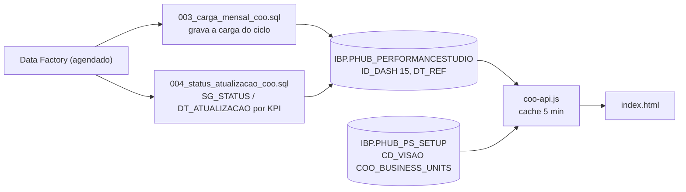

# COO Business Units Dashboard (atual e Historical)

Dois dashboards do COO por Business Unit e site, lendo as **mesmas cargas** do COO
(`ID_DASH = 15`) em `IBP.PHUB_PERFORMANCESTUDIO`:

| | COO Business Units Dashboard | COO Business Units Dashboard Historical |
|---|---|---|
| Endereço | `/VBM-Performance-Hub/COO-Business-Units-Dashboard/` | `/VBM-Performance-Hub/COO-Business-Units-Dashboard-Historical/` |
| Visão | mês, trimestre do mês e ano do ciclo; situação de atualização por KPI | série **anual** desde 2017 |
| Filtros | Ciclo, Business Units (País › Site), Visão, Ano, Trimestre, Mês, Delta | Ciclo, Business Units, Anos (vários), Séries (Budget / Act-Fcst), Delta |

Contrato comum (pastas, `portal.js` / `server.js` / `coo-api.js`, `runQuery`, pool PRD):
[performance-hub.md](performance-hub.md). O padrão visual dos filtros (rótulo em itálico, seletor
País › Site, segmentados e interruptor) é a referência para os outros dashboards do Portal.

## COO Business Units Dashboard

### Fluxo de dados

- **Ciclo** = uma carga (`DT_REF`, dia 1 do mês). A carga roda no começo do mês com
  `DT_REF = mês de (GETDATE() − 2 dias) − 1 mês` e grava de janeiro do ano anterior a dezembro do ano
  do último mês realizado.
- **Sem carga, não há dados:** não existe consulta ao vivo de reserva.
- **A SQL não é reescrita na API:** os scripts do time de dados em `database/` são lidos como foram
  entregues. A única troca é `DASH.ID_DASH = 15` por `@idDash`, com o número de ocorrências conferido.
  Se o script mudar e a troca não acontecer, o módulo **falha ao subir**, em vez de consultar o
  dashboard errado. Uma consulta nova = um script novo + uma entrada em `CONSULTAS`.
- **Configuração da tela** (seletores dos cards, apelidos de KPI): JSON em `IBP.PHUB_PS_SETUP`,
  `CD_VISAO = 'COO_BUSINESS_UNITS'` (`005_config_coo.sql`, registro inativo para não aparecer no
  Studio). Sem o registro, vale o padrão do código.

### API (`.../COO-Business-Units-Dashboard/api`)

| Rota | O que devolve |
|---|---|
| `GET /ping` | diagnóstico sem banco |
| `GET /ciclos` | cargas gravadas, da mais recente para a mais antiga |
| `GET /config` | seletores e apelidos de KPI |
| `GET /filtros?ciclo=` | sites com dados, anos e meses, último mês realizado |
| `GET /indicadores?site=&ano=&mes=&ciclo=` | Budget e Act/Fcst por KPI do site no mês, trimestre e ano |
| `GET /atualizacao?site=&ano=&mes=&ciclo=` | situação de atualização por KPI (consulta à parte, para não atrasar os gráficos) |
| `GET /chart-data`, `/atualizacoes`, `/sites` | resultado bruto (todas as BUs): **só com `COO_DIAGNOSTICO=1`** |

- `ciclo` = `AAAA-MM`. Sem ele, vale a carga mais recente.
- **Resiliência:**
  - cache de 5 min (`COO_CACHE_TTL_S`);
  - `?fresco=1` relê o banco se o resultado tiver mais de 15 s (`COO_FRESCO_S`);
  - com o banco fora, serve o último resultado por até 2 h (`COO_DESATUALIZADO_MAX_S`), com o selo
    "banco indisponível";
  - limite de 240 pedidos por minuto por usuário (429).
- **Na tela:**
  - a API é chamada só nos caminhos do próprio COO, e 5xx, 403 e 429 não são repetidos;
  - timeout de 75 s;
  - filtros e seletores ficam na URL, então o link pode ser compartilhado.

### Banco (`database/`)

| Script | Uso |
|---|---|
| `001_coo_dashboard.sql` | consulta MONTH/QUARTER/YEAR (UNION ALL), carregada pela API (`/chart-data`, diagnóstico) |
| `002_coo_dashboard_atualizacao.sql` | situação por KPI, carregada pela API (`/atualizacoes`, diagnóstico) |
| `003_carga_mensal_coo.sql` | **carga do ciclo** (Data Factory) |
| `004_status_atualizacao_coo.sql` | `SG_STATUS` ('S' atualizado / 'N' pendente) e `DT_ATUALIZACAO`, a partir de `IBP.LOG_PEDRAVISAOCONSOLIDADA` (Data Factory, depois da carga) |
| `005_config_coo.sql` | configuração da tela em `IBP.PHUB_PS_SETUP` |
| `006_validacao_regras_vbm.sql` | somente leitura: compara o valor do COO com o que a carga do Studio gravaria (datas, trimestre, ano, mês do ciclo) |

### Variáveis

| Variável | Padrão |
|---|---|
| `COO_ID_DASH` | 15 |
| `COO_CACHE_TTL_S` / `COO_FRESCO_S` / `COO_DESATUALIZADO_MAX_S` | 300 / 15 / 7200 |
| `COO_DIAGNOSTICO` | desligado (`1` libera as rotas brutas) |
| `COO_ACESSO_LOCAL_EMAIL` | só no standalone, com `NODE_ENV=development`: e-mail simulado |
| `PERFORMANCEHUB_SQL_*` | ver o contrato comum |

### Testes e auditoria

- `tests/coo-api.test.js` (`npm test` na pasta): `node --test` com `runQuery` falso.
- `docs/AUDITORIA-TECNICA.md` (28/10/2026): auditoria completa. Ainda abertos:
  - **DB-01:** chave `CONCAT(ID_SITE, ID_OPERACAO, ID_KPI)` pode colidir (validar no banco);
  - **SEC-01:** qualquer usuário do Portal vê todos os sites e os dados financeiros;
  - **HC-02/HC-05:** layout e regras de negócio no JavaScript.

## COO Business Units Dashboard Historical

- **Fonte:** a mesma tabela e o mesmo `ID_DASH` do COO, só a visão **anual** (`CD_PERIODO = 'YEAR'`)
  desde `COO_HIST_ANO_INICIAL` (2017), por `database/001_coo_historical_anual.sql` (parâmetros
  `@idDash`, `@dtRef`, `@anoIni`).
- **Ano a ano:** para cada ano, vale a carga mais recente até o ciclo escolhido.
- **Business Units:** só as do Historical (`BUS_HISTORICAL`: Salobo, Sossego, Onça Puma, Manitoba, VNL,
  Ontario, IR). As refinarias da IR (Clydach, Matsusaka; IDs 16 e 26) entram nos dados dos cards de
  produção da IR, mas não viram unidade no menu.
- **API:** `GET /ping`, `/ciclos`, `/config` (o mesmo JSON do COO), `/filtros?ciclo=`,
  `/indicadores?site=&ciclo=`.
- **Resiliência e variáveis:** as do COO (cache, fresco, desatualizado, 240 pedidos por minuto,
  `COO_ID_DASH`), mais `COO_HIST_ANO_INICIAL`.
- **Testes:** `tests/coo-api.test.js`.
