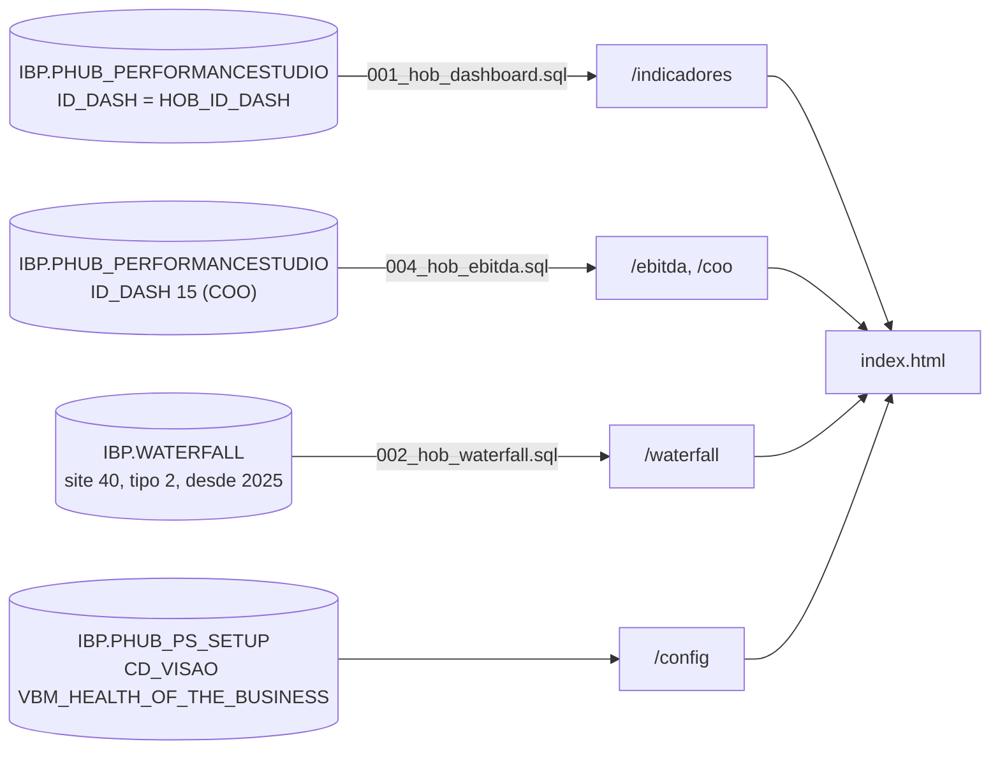

# VBM Health of the Business

Visão consolidada da saúde do negócio da Vale Base Metals (VBM, Copper e Nickel): produção,
vendas, EBITDA, All-in (AISC), Capex e pontes de EBITDA e FCF.

- **Endereço:** `/VBM-Performance-Hub/VBM-Health-of-the-Business/`
- **Código:** `VBM-Performance-Hub/VBM-Health-of-the-Business/` (`hob-api.js`)
- **Contrato comum:** [performance-hub.md](performance-hub.md)
- **Proposta de layout e pendências:** `docs/PROPOSTA-LAYOUT.md` da pasta

## Situação

**Parcialmente ligada ao banco.**

- **`HOB_ID_DASH` ainda não está definido no `app.yaml`.** Por isso, as rotas da carga respondem
  503 `ID_DASH_PENDENTE` e a página usa os **dados de demonstração** (`window.HOB_DATA`, selo
  "Dados demo").
- **O que já vem do banco:**
  - o **FCF YEAR** (`IBP.WATERFALL`);
  - o **EBITDA** e os gráficos lidos da carga do COO (`ID_DASH 15`).

## Telas

- **Vale Base Metals | Consolidated View:**
  - EBITDA (B × A|F, com seletor VBM · Copper · Nickel · Other);
  - ponte do EBITDA do ano;
  - Capex | S Curve (12 meses + B/F do ano);
  - ponte do FCF do ano.
- **Copper Business / Nickel Business:** o mesmo molde nas duas, com Production, Sales, EBITDA, Capex,
  All-In (AISC) e FCF acumulado.
  - No Copper, o AISC tem seletor All-in · Sustaining · Cost · By Product.
  - No Nickel, o AISC é um gráfico empilhado (ainda em avaliação).
- **Filtros** no padrão do COO: Cycle, Business Units (VBM · Copper · Nickel), Year, Quarter, Month e Delta.
  Ficam na URL (`?bu=cu&ano=2026&mes=9&allin=cost`).
- **Cores:** Budget em cinza, Act/Fcst em azul; nas pontes, verde é ganho e vermelho é perda.

## Fontes de dados

- **Carga própria:** `003_carga_mensal_hob.sql` grava em `IBP.PHUB_PERFORMANCESTUDIO` com o `ID_DASH`
  do HoB, no mesmo formato do COO, uma vez por mês (Data Factory). A leitura (`001_hob_dashboard.sql`)
  usa mês (`MONTH`) e ano (`YEAR`), com a série 1 = Budget e a série 3 = Act/Fcst.
- **Configuração da tela:** JSON em `IBP.PHUB_PS_SETUP` (`005_config_hob.sql`, registro inativo para não
  aparecer no Studio). Sem o registro, vale `CONFIG_PADRAO` no código.
  - `bus`: sites de cada Business Unit.
  - `indicadores`: série da tela → nome do KPI em `IBP.DASHBOARD.NM_KPIS_DASH` (o primeiro que existir).
  - `pontes`: degraus na ordem, com `tipo` `tot` | `d` | `sub` | `ref` | `zero`, mais `kpi`, `serie`
    (`B` ou `AF`) e `ano` (0 = ano da tela, −1 = anterior).
  - `fcf`: site, tipo e ano inicial do `IBP.WATERFALL` (40, 2, 2025).
  - `ebitda`: `idDash` (15) e `idKpi` (73).
- **EBITDA e demais gráficos do COO:** `004_hob_ebitda.sql` lê a carga do COO (`ID_DASH 15`, KPI 73).

## API (`.../VBM-Health-of-the-Business/api`)

| Rota | O que devolve |
|---|---|
| `GET /ping` | diagnóstico sem banco |
| `GET /ciclos` | cargas gravadas (`DT_REF`) |
| `GET /config` | configuração em uso (banco ou padrão) |
| `GET /indicadores?ciclo=` | tudo o que a tela desenha, no formato de `window.HOB_DATA` (503 `ID_DASH_PENDENTE` sem `HOB_ID_DASH`) |
| `GET /ebitda?ciclo=` | EBITDA por segmento (carga do COO) |
| `GET /coo?ciclo=` | demais gráficos lidos da carga do COO (`coo.kpis`) |
| `GET /waterfall` | FCF YEAR por ano; `?bruto=1` (só com `HOB_DIAGNOSTICO=1`) devolve a tabela como veio |
| `GET /waterfall/estrutura` | colunas, tipos e mapeamento de `IBP.WATERFALL`, sem valores (para conferir por que o FCF não veio) |

Resiliência igual à do COO: cache, `?fresco=1`, último resultado com o banco fora e 240 pedidos por
minuto.

## Variáveis

| Variável | Padrão |
|---|---|
| `HOB_ID_DASH` | **não definido** (dados demo) |
| `HOB_CACHE_TTL_S` / `HOB_FRESCO_S` / `HOB_DESATUALIZADO_MAX_S` | 300 / 15 / 7200 |
| `HOB_DIAGNOSTICO` | desligado |
| `HOB_ACESSO_LOCAL_EMAIL` | só no standalone em desenvolvimento |
| `PERFORMANCEHUB_SQL_*` | ver o contrato comum |

## Testes

`tests/hob-api.test.js` (`node --test`, banco simulado).

## Pendências

1. A consulta de origem de `003_carga_mensal_hob.sql` e o `ID_DASH` do dashboard. Depois, declarar
   `HOB_ID_DASH` no `app.yaml`.
2. Conferir as colunas de `IBP.WATERFALL` no Portal (`api/waterfall/estrutura`).
3. Validar com o negócio o nome e a ordem das categorias das pontes (EBITDA e FCF).
