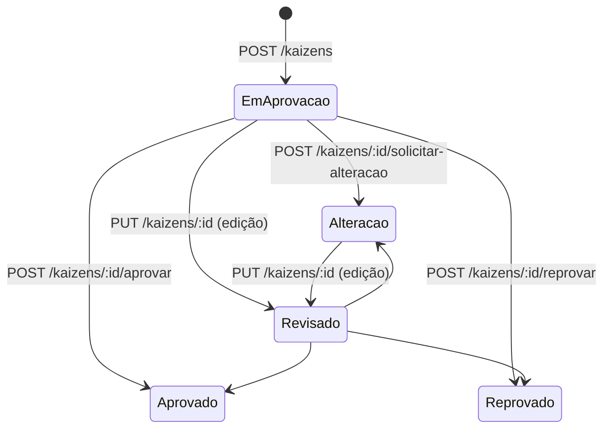

# VBM Kaizen

Programa Kaizen da Vale Base Metals: cadastro de iniciativas de melhoria contínua, fila de
aprovação, biblioteca, dashboard e administração dos cadastros.

- **Endereço:** `/VBM-Kaizen-App/`, com a API em `/api` na raiz do Portal
- **Código:** `VBM-Kaizen-App-DEV/` ou `VBM-Kaizen-App-PROD/`, escolhida por `KAIZEN_PASTA` (hoje **DEV**)
- **Stack:** Node.js/Express (`server.js` com cerca de 6,8 mil linhas + `dashboard-kaizen.js`), HTML/CSS/JS sem
  framework, Azure SQL (`mssql`), Azure Blob, Microsoft Graph (MSAL) no navegador
- **Documentos da pasta:** `README.md`, `docs/ESTRUTURA.md` (estrutura física e convenções de cache),
  `docs/evidencias-secrets.md`, `database/DER_VBM_Kaizen_CI.html` (modelo de dados), `tests/README.md`

## DEV × PROD

As duas pastas são a mesma aplicação em momentos diferentes. A **PROD** não tem o Dashboard
(`dashboard.html`, `dashboard-kaizen.js`) nem as mudanças mais recentes. Promover = levar o
código da DEV para a PROD e trocar **juntos** `KAIZEN_PASTA` e `KAIZEN_AZURE_SQL_DATABASE` no
`app.yaml`. A URL `/VBM-Kaizen-App/` não muda.

## Telas

| Arquivo | O que é | Acesso |
|---|---|---|
| `index.html` | painel inicial | todos |
| `kaizen-novo.html` | cadastro e edição em 4 etapas (fotos antes/depois, resultados, desperdícios, equipe) | todos |
| `biblioteca.html` | repositório: filtros, drill-down de hierarquia N3–N8, paginação, exportação Excel, impressão PDF/PPT | todos |
| `dashboard.html` | indicadores (atual + histórico), filtros por hierarquia do MDM, Excel | todos |
| `aprovacao.html` | fila de aprovação | `kzn_aprovador` ativo |
| `admin.html` | abas: Aprovadores, Categorias, Pot. Replicação, Red. Desperdícios, Resultados, Tipo Resultados, Tipos Kaizen, Status Kaizen, Usuários | `kzn_admin` ativo |

Links antigos na raiz do Portal (`/admin.html`, `/aprovacao.html`, `/biblioteca.html`,
`/kaizen-novo.html`) recebem 302 para `/VBM-Kaizen-App/...`.

## Acesso e identidade

- O usuário vem do `X-Forwarded-Email` e é casado com o MDM (`kzn_mdm_hierarquia`) para obter o
  `ID_USUARIO` gravado nos cadastros.
- **Deny by default** nas telas de papel (`PAGINAS_RESTRITAS`): sem cabeçalho, sem MDM, erro de banco
  ou papel inativo, o acesso é negado. O caminho é normalizado antes da checagem (`/%61dmin.html`
  não escapa).
- O perfil (MDM + papéis) fica em cache curto por e-mail, porque abrir a Biblioteca dispara cerca
  de oito chamadas de API.
- A API repete as checagens, porque o front só esconde botões:
  - **editar** exige dono ou admin e status editável (em aprovação ou alteração);
  - **excluir** exige dono ou admin, status fora de Aprovado/Rejeitado e registro da tabela atual.
- O Kaizen **não** passa pela regra `IBP.USERS` do Portal.

## Ciclo de vida (status)

`kzn_pedravisaoconsolidada.ID_STATUS` aponta para `kzn_status`. O código não fixa IDs: resolve
cada momento pelo **nome** cadastrado (`idDoStatus()`, sem acento e sem diferenciar maiúsculas):

| Momento | Nomes aceitos em `kzn_status` (exemplos) |
|---|---|
| em aprovação | Aguardando aprovação, Em aprovação, Awaiting approval |
| aprovado | Aprovado, Concluído, Approved |
| reprovado | Reprovado, Rejeitado, Rejected |
| revisado | Revisado, Em revisão, Reviewed |
| alteração | Solicitado alterações, Ajuste solicitado, Request changes |

- **Edição:** só nos status "em aprovação" e "alteração" (`idsStatusEditaveis`, reserva `[3, 4]`).
  Toda edição grava **Revisado** (`ID_STATUS_REVISADO = 5`, conferido no cadastro: precisa existir,
  estar ativo e ter nome de "Revisado"; senão a API responde 503). O status nunca vem do navegador.
- **Fila de aprovação:** lista "em aprovação" e "revisado".
- **Histórico:** um Kaizen do histórico (`ORIGEM = 'H'`) também pode ser editado; a gravação vai para a
  tabela `kzn_hist_*`.
 Se um nome não for encontrado, o log
mostra o que existe no cadastro e a API devolve "Status não encontrado no cadastro".

## API (`/api`)

| Grupo | Rotas |
|---|---|
| Kaizens | `GET /kaizens` (Biblioteca, com filtros e paginação), `GET /kaizens/:id`, `GET /kaizens/:id/edicao`, `GET /kaizens/resumo`, `GET /kaizens/filtros`, `GET /kaizens/recursos`, `GET /kaizens/titulo-existe`, `GET /kaizens/exportar` (Excel), `POST /kaizens`, `PUT /kaizens/:id`, `DELETE /kaizens/:id` |
| Decisão | `POST /kaizens/:id/aprovar`, `/reprovar`, `/solicitar-alteracao`, `/aviso` |
| Imagens | `POST /kaizens/imagem` (upload), `GET /kaizens/imagem` (leitura: Blob ou Volume antigo) |
| Aprovação | `GET /aprovacoes`, `GET /aprovacoes/contagem` |
| Cadastros (admin) | `aprovadores` (CRUD + `/mdm`, `/status`), `usuarios` (CRUD + `/empresas`, `/unidades`, `/formulario`, `/status`) e os cadastros bilíngues das abas |
| Dashboard | `GET /dashboard/dados`, `GET /dashboard/detalhes`, `POST /dashboard/exportar`, `GET /hierarquia/opcoes` (em `dashboard-kaizen.js`) |
| Apoio | `GET /me` (usuário logado, também usado pelas outras aplicações), `GET /moedas`, `GET /test` |

- **Ordem importa:** as rotas literais (`/kaizens/resumo`, `/filtros`, `/titulo-existe`) são
  registradas antes de `/kaizens/:id`.
- **Medição:** todo `/api` responde com `Server-Timing` (`sql`, `fora`, `total`), e o log marca
  `[lento]` acima de 500 ms com o tempo de banco separado.
- **Cache:** `/api` é sempre `no-store`.

## Dados

Esquema `ci` (`AZURE_SQL_SCHEMA`), na base `KAIZEN_AZURE_SQL_DATABASE`. Cada tabela pode ser
renomeada por uma variável `AZURE_SQL_*_TABLE`.

| Grupo | Tabelas |
|---|---|
| Kaizen (atual) | `kzn_pedravisaoconsolidada` (cabeçalho), `kzn_resultado_kaizen`, `kzn_kaizen_desperdicio`, `kzn_membros_equipe`, `kzn_membros_envolvidos`, `kzn_kaizen_hierarquia` (fotografia N3–N8 do líder na gravação) |
| Histórico | `kzn_hist_*` com a mesma estrutura. A Biblioteca e o Dashboard leem atual UNION ALL histórico, com coluna `ORIGEM` = `A` ou `H`. Excluir só vale para `A` |
| Log | `kzn_log_pedravisaoconsolidada` e `_detalhe` (última atualização real de cada registro) |
| Papéis e pessoas | `kzn_admin`, `kzn_aprovador` (+ `kzn_hist_aprovador`), `kzn_mdm_hierarquia` (+ `kzn_hist_mdm_vbm_terc`), `kzn_tipo_usuario` |
| Cadastros | `kzn_status`, `kzn_categoria`, `kzn_tipo_kaizen`, `kzn_replicacao`, `kzn_desperdicio`, `kzn_resultados`, `kzn_tipo_resultado`, `kzn_moeda`, `kzn_motivo_reprovacao`, `kzn_idioma` |
| Outras | `kzn_pendenciaconsolidada` (contagem por categoria), `KZN_TB_NOTIFICACAO` (notificações) |

- Os cadastros são **bilíngues** (`ID_IDIOMA` PT/EN). A chave funcional é a mesma nos dois idiomas.
- Os scripts em `database/` (índices, `otimizacao_dashboard.sql`, preenchimento de hierarquia,
  colunas novas) rodam **à mão**. Alguns recursos dependem deles (ex.: `criar_membros_envolvidos.sql`).

## Arquivos (fotos)

- **Novas:** Azure Blob (`azure-blob.js`, SAS em `AZURE_STORAGE_SAS_TOKEN`), em
  `05 - Kaizen/01 - Imagens/01 - Antes` e `/02 - Depois`. O upload grava `TEMP_…` e, ao salvar,
  copia para `<ID_KAIZEN>.<ext>`.
- **Antigas:** Volume `franquia_bmsa_insight.ci.kaizen`, só leitura (`databricks-fs.js`, com as credenciais
  do service principal do app). O caminho fica em `URL_IMG_ANTES` / `URL_IMG_DEPOIS`.
- O SAS atual não tem delete (`sp=racw`): cada cadastro novo deixa um `TEMP_` órfão.

## Dashboard

- **Fonte:** a mesma da Biblioteca (atual + histórico); ano e mês pela `DT_REFERENCIA`.
- **Hierarquia:** a fotografia `kzn_kaizen_hierarquia`. Um Kaizen sem fotografia usa a linha do líder
  no MDM (desligável com `KAIZEN_DASHBOARD_HIERARQUIA_MDM=false`). `NULL`, `N.A` e vazio contam como
  "Em branco".
- **Desempenho:**
  - Uma consulta monta a base, compartilhada por todos. Ela fica em cache no servidor
    (`KAIZEN_DASHBOARD_CACHE_MS`, 5 min) e é servida vencida enquanto a nova é montada
    (stale-while-revalidate).
  - A base é aquecida cerca de 20 s depois de subir e a cada `KAIZEN_DASHBOARD_AQUECER_MS` (30 min,
    mínimo 5 min). `KAIZEN_DASHBOARD_AQUECER=false` desliga.
  - Há uma cópia gzip no Blob (`KAIZEN_DASHBOARD_COPIA`, padrão `00 - Sistema/dashboard-base.json.gz`),
    para o app subir com dados.
  - O navegador também guarda uma cópia (Cache API).
  - Os filtros em cascata rodam no navegador. O ano atual vem pré-selecionado.
- Índices recomendados: `database/otimizacao_dashboard.sql`.

## E-mails de decisão

- Montados por `email-kaizen.js` e **enviados pelo navegador** (`js/envio-email.js`, Microsoft Graph,
  token delegado via `js/msal-config.js`) pela caixa `PCI.Base.Metals@Vale.com`
  (`KAIZEN_EMAIL_REMETENTE`). Com `KAIZEN_EMAIL_DO_USUARIO=true`, saem pela caixa de quem decide.
- **Hoje bloqueados:** o locatário exige consentimento de administrador do Entra (User.Read +
  Mail.Send / Mail.Send.Shared). As duas saídas possíveis estão documentadas no `app.yaml`.

## Front-end

- Design system em `css/vbm-app.css` (tokens `--vbm-*`), comportamento comum em `js/vbm-app.js`
  (modais, abas, toasts).
- Uma aba do admin = um arquivo em `js/`. As abas bilíngues usam `cadastro-bilingue.js`; `categorias.js`
  é autossuficiente de propósito.
- **Ícones dos cadastros do admin** (`assets/icons/<aba>/`, catálogo em `assets/icons/icones.json`):
  SVG do Font Awesome Free 6.6.0 com o azul `#1a8bbf` gravado (no tema escuro o CSS clareia). A paleta
  de cada aba está no modal do `admin.html`:
  - Categorias: 16, de Segurança e 5S a Automação e Água;
  - Pot. Replicação (área do processo): Global, Concentração, Britagem, Mina a céu aberto, Mina subterrânea,
    Fundição, Refinaria, Usina, Porto, Ferrovia, Projetos, Outros e Sem replicação;
  - Red. Desperdícios: os 8 desperdícios do Lean (Defeitos, Superprodução, Espera, Talento não utilizado,
    Transporte, Estoque, Movimentação, Processamento extra) e Energia, Ideia, Segurança e Manutenção;
  - Resultados: 13, de Redução de custo a Satisfação;
  - Status: Aprovado, Reprovado, Em aprovação, Rascunho, Revisado, Pendente, Implementado e Cancelado.

  O ícone escolhido vai para `URL_ICONE`. Quando o registro não tem escolha de verdade (sem ícone, com o
  padrão da aba, com um ícone da paleta antiga ou com o mesmo ícone de outro registro), o cartão mostra o
  ícone pelo nome (`iconesPorNome` em cada `js/<aba>.js` e em `js/categorias.js`, PT e EN), e editar
  grava esse ícone. `database/atualizar_icones_desperdicios.sql` e `atualizar_icones_replicacao.sql` gravam de uma vez os
  de Waste Reduction e de Replication Potential. Tipo Resultados e Tipo Kaizen não têm essa coluna: o ícone
  sai do nome (`iconesPorNome` em `js/tiporesultados.js` e `js/tiposkaizen.js`; Financeiro = saco de
  dinheiro, Simples = raio, Complexo = engrenagens…). Para um ícone novo: incluir em
  `ABAS`/paleta, gerar o SVG no mesmo formato e regerar o subconjunto da fonte
  (`database/README-subset-fontawesome.md`), senão a paleta mostra um quadrado vazio.
- Impressão do Kaizen (`js/impressao-kaizen.js`): folha A4/A3/A2 em PDF (html2canvas-pro + jsPDF) e PPT
  (`js/vendor/pptxgenjs-3.12.0.bundle.min.js`), carregados sob demanda.
- Cache: arquivos com hash no nome são `immutable` (1 ano); o resto é `no-cache` + ETag.

## Variáveis

| Variável | Padrão |
|---|---|
| `KAIZEN_PASTA` | primeira pasta existente |
| `KAIZEN_AZURE_SQL_DATABASE` (ou `AZURE_SQL_DATABASE`) | — |
| `AZURE_SQL_SERVER`, `_PORT`, `_USER`, `_PASSWORD`, `_SCHEMA` | `_SCHEMA` padrão `dbo` (o `app.yaml` usa `ci`) |
| `AZURE_SQL_TABLE` e `AZURE_SQL_*_TABLE` | nomes `kzn_*` acima |
| `AZURE_STORAGE_ACCOUNT`, `_CONTAINER`, `_SAS_TOKEN` | — |
| `KAIZEN_DASHBOARD_CACHE_MS` / `_AQUECER` / `_AQUECER_MS` / `_COPIA` / `_HIERARQUIA_MDM` | 300000 / true / 1800000 / `00 - Sistema/dashboard-base.json.gz` / true |
| `KAIZEN_EMAIL_REMETENTE`, `KAIZEN_EMAIL_DO_USUARIO`, `KAIZEN_APP_URL` | `PCI.Base.Metals@Vale.com`, desligado, endereço do app |
| `DATABRICKS_HOST`, `_CLIENT_ID`, `_CLIENT_SECRET` | injetados pelo runtime (leitura do Volume) |

## Testes

`tests/regressao.sh` sobe o `server.js` em 7 portas, cada uma com um dublê do `mssql`
(`fake-mssql*.js`, sem banco real), e roda as suítes de API e de tela (Playwright): gate do MDM,
dashboard, ficha, impressão, lixeira, notificações, fotos. Para variáveis fictícias, use
`tests/env-exemplo.sh`. O README da pasta cita um `tests/verifica-segredos.sh` que **não existe** no
repositório.

## Pontos de atenção

- SAS do Blob em texto puro e sem delete; senha e SAS antigos no histórico do git (rotacionar).
- E-mails bloqueados pelo consentimento do Entra.
- Aplicação em **DEV** no Portal (`KAIZEN_PASTA=VBM-Kaizen-App-DEV`, base `BDIBPBMSA_DEV`).
- `package-lock.json` no `.gitignore` da pasta: as versões podem variar entre deploys.
- Há arquivos duplicados com data no nome em `js/` (ex.: `status 2026-10-06 15_50_15.js`), cópias
  manuais que as telas não carregam.
