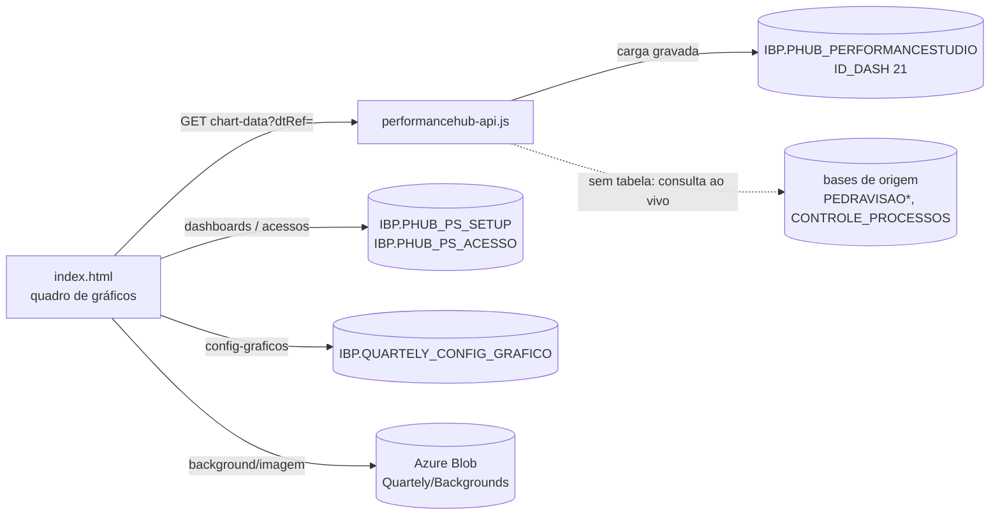

# VBM Performance Studio

Montador de dashboards de produção: cada pessoa cria quadros com gráficos configuráveis,
compartilha com editores e publica para quem usa o Hub.

- **Endereço:** `/VBM-Performance-Hub/VBM-Performance-Studio/` (o antigo `/VBM-Performance-Studio/`
  recebe 301 para cá)
- **Código:** `VBM-Performance-Hub/VBM-Performance-Studio/`
- **Stack:** Node/Express (`performancehub-api.js`), uma tela HTML/JS grande (`index.html`, cerca de
  7,4 mil linhas), ExcelJS no navegador
- **Fonte dos dados:** `IBP.PHUB_PERFORMANCESTUDIO` com `ID_DASH = 21` (VBM Production Analytics)
- Contrato comum: [performance-hub.md](performance-hub.md)

## Funcionamento

- **Dados:** `GET /chart-data?dtRef=AAAA-MM` lê a carga do mês de referência. Sem `dtRef`, vale a mais
  recente. Se a tabela não existir na base, a API usa a **consulta ao vivo**
  (`CHART_DATA_AO_VIVO_SQL`), com a mesma lógica da carga mensal. Uma referência sem carga recebe
  404 `SEM_CARGA`.
- **Referências:** `GET /chart-data/referencias` lista os meses com carga, para o seletor de YTD.
- **Cache:** 5 min por chave (`chart-data:<dtRef>`). "Sem carga" não entra no cache.
- **Editor:** barra lateral com as visões Dashboards, Filtros, Adicionar gráfico, Fundo e Excluir.
  Os filtros (Produto, Site…) são por gráfico, e o Site acompanha o Produto escolhido.
- **Fontes:** 100% na aba Fontes equivale a 80% do tamanho antigo (`FONTE_BASE`). O script
  `database/005_fontes_base_80.sql` converte dashboards antigos.

## Dashboards, donos e editores

| Papel | Pode |
|---|---|
| Dono (`NM_USUARIO_CRIACAO`) | alterar, ativar/desativar, excluir, definir editores |
| Editor (linha em `IBP.PHUB_PS_ACESSO`) | alterar e reutilizar |
| Demais usuários do Hub | ver os dashboards ativos |

- Desativar grava `SG_ATIVO = 'N'`: o dashboard some para os outros, e o dono continua vendo com a
  marca "Inativo".
- Excluir apaga a linha, e os editores saem junto (`ON DELETE CASCADE`).
- Toda rota de dashboard exige `X-Forwarded-Email` (sem ele, 401). A permissão é conferida no servidor
  (`dashboardPermitido`).
- Os editores são escolhidos entre os usuários de `IBP.USERS`, com a mesma regra de e-mail do Portal
  (`descobrirColunaEmail`).

## API (`/VBM-Performance-Hub/VBM-Performance-Studio/api`)

| Rota | O que faz |
|---|---|
| `GET /ping`, `GET /health` | diagnóstico (o `health` testa o banco) |
| `GET /chart-data?dtRef=`, `GET /chart-data/referencias`, `GET /sites` | dados dos gráficos |
| `GET` / `PUT /config-graficos` | configurações de apresentação salvas (título, casas, unidade, cores) |
| `GET` / `PUT /background`, `POST` / `GET /background/imagem` | fundo do quadro (imagem no Blob) |
| `GET` / `POST /dashboards`, `PUT` / `DELETE /dashboards/:id`, `PUT /dashboards/:id/ativo` | dashboards |
| `GET` / `PUT /dashboards/:id/acessos`, `GET /usuarios` | editores |

Todas as respostas são `no-store`.

## Banco (`database/`)

| Script | O que é |
|---|---|
| `001_config_grafico.sql` | cria `IBP.QUARTELY_CONFIG_GRAFICO` (só apresentação, em JSON) |
| `002_snapshot_mensal.sql` | estrutura de `IBP.PHUB_PERFORMANCESTUDIO` (proposta original; a tabela já é usada pelo COO e pelo Health of the Business) |
| `003_carga_mensal.sql` | **carga mensal**: grava o resultado da consulta ao vivo para um `DT_REF`. Pode rodar de novo (apaga e regrava aquele `DT_REF` + `ID_DASH` numa transação). Parâmetros: `@DT_REF` (padrão `CONTROLE_PROCESSOS.DT_INI` − 1 mês, `ID_PROCESSO = 2`), `@NM_USUARIO`, `@ID_DASH` (21), `@ANOS_ANTES` |
| `004_dashboards.sql` | `IBP.PHUB_PS_SETUP` e `IBP.PHUB_PS_ACESSO` |
| `005_fontes_base_80.sql` | conversão das fontes (ver acima) |

## Variáveis

| Variável | Padrão |
|---|---|
| `PERFORMANCEHUB_SQL_*` / `PERFORMANCEHUB_AZURE_SQL_DATABASE` | servidor e base PRD, login do Portal |
| `PERFORMANCEHUB_CONFIG_TABLE` | `IBP.QUARTELY_CONFIG_GRAFICO` (formato `ESQUEMA.TABELA`, validado) |
| `PERFORMANCEHUB_BG_PASTA` | `Quartely/Backgrounds` (pasta do Blob) |
| `AZURE_STORAGE_*`, `KAIZEN_PASTA` | Blob, usando o `azure-blob.js` da pasta do Kaizen. Sem Blob, o upload do fundo responde 503 e o resto funciona |

## Pontos de atenção

- `ID_DASH = 21` está fixo no código e repetido na consulta ao vivo.
- Os nomes `QUARTELY_*` e `Quartely/` vêm do projeto anterior ("Quartely") e foram mantidos para não
  migrar dados.
- Sem testes automatizados na pasta.
