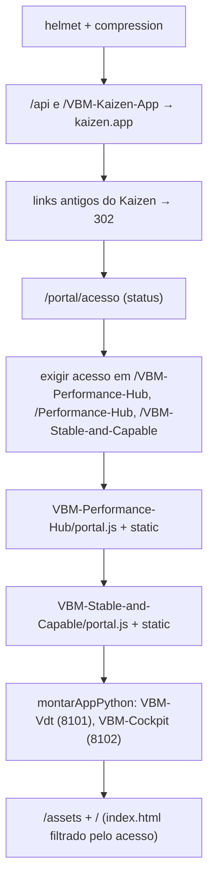

# Núcleo do Portal

O processo que hospeda todas as aplicações. Não tem regra de negócio: entrega a página inicial,
aplica o controle de acesso e monta cada aplicação na própria pasta.

- **Endereço:** `/`
- **Código:** raiz do repositório
- **Stack:** Node.js, Express 5, `helmet`, `compression`, `mssql`

## Arquivos

| Arquivo | Papel |
|---|---|
| `server.js` | ponto de entrada (`npm start`): monta as aplicações, o acesso e a página inicial; escuta em `DATABRICKS_APP_PORT` / `PORT` (padrão 8000) |
| `portal-acesso.js` | controle de acesso: `IBP.USERS` com `CD_MATRICULA` |
| `apps-python.js` | sobe as aplicações Python (VDT, Cockpit) como processos filhos e encaminha as requisições |
| `index.html`, `assets/` | página inicial: um card por aplicação, barra superior e Configurações (skill `setup-dashboards`) |
| `app.yaml` | configuração do Databricks App: variáveis e resources |
| `package.json`, `node_modules/` | dependências Node de todo o Portal (o `node_modules` é versionado) |
| `requirements.txt` | bibliotecas Python de todas as aplicações (instaladas pelo Databricks Apps no deploy) |
| `portal.js` | **sem uso**: cópia antiga do `VBM-Performance-Hub/portal.js`, que ninguém carrega |

## Montagem (`server.js`)

- **Kaizen:** a pasta vem de `KAIZEN_PASTA`. Sem a variável, vale a primeira que existir entre
  `VBM-Kaizen-App`, `-PROD` e `-DEV`. O valor escolhido é regravado em `process.env.KAIZEN_PASTA`,
  porque as outras aplicações carregam o `azure-blob.js` de lá. Se nenhuma pasta tiver `server.js`,
  o Portal não sobe, e esse é o único caso em que isso acontece.
- **Barra final:** `/VBM-Kaizen-App` e `/VBM-Stable-and-Capable` sem barra recebem 301 para a
  versão com barra, senão os caminhos relativos das telas apontariam para a raiz.
- **Falhas isoladas:** Stable & Capable, VDT e Cockpit são montados em `try/catch`, e o Hub
  isola cada subaplicação. O `kaizen.aoIniciar()` roda depois do `listen`: confere os arquivos
  das telas, registra no log se as credenciais chegaram (só os nomes, nunca os valores) e testa a
  conexão com o Azure SQL.
- **Página inicial:** é servida com `Cache-Control: no-store` e validada no servidor. Sem acesso,
  o HTML sai **sem** o bloco `<nav class="cards">` (403 se negado, 503 se o banco falhou), então
  não há links a descobrir pelo DevTools.

## Controle de acesso (`portal-acesso.js`)

`criarControleDeAcesso({ conexoes })` devolve `{ validar, exigir, rotaStatus }`.

| Item | Comportamento |
|---|---|
| Identidade | `X-Forwarded-Email` (injetado pelo proxy do Databricks Apps) |
| Regra | o e-mail existe em `IBP.USERS` com `CD_MATRICULA` preenchido |
| Banco | **só PRD** (`BDIBPBMSA_PRD`), pela conexão que o `VBM-Performance-Hub/portal.js` devolve (`{ runQuery }`) |
| Coluna de e-mail | `PORTAL_USERS_EMAIL_COLUMN`; sem ela, a primeira entre `CD_EMAIL`, `DS_EMAIL`, `NM_EMAIL`, `EMAIL`, `TX_EMAIL`, `CD_UPN`, `UPN`, `DS_LOGIN`, `CD_LOGIN`, `LOGIN`, ou uma coluna que case com `E_?MAIL\|UPN\|LOGIN` (descoberta em `INFORMATION_SCHEMA`) |
| Cache | por e-mail, em memória: autorizado 10 min, negado 1 min, até 5000 entradas. Falha de banco **não** entra no cache |
| Respostas | `exigir`: 403 (negado) ou 503 (erro) em JSON; `GET /portal/acesso`: status para a página inicial |
| Reuso | `descobrirColunaEmail` é exportada para o Performance Studio validar editores com a mesma regra |

Se o `VBM-Performance-Hub/portal.js` não devolver `{ runQuery }` (versão antiga), o log avisa e o
acesso fica **bloqueado** ("não foi possível validar") até a versão nova ser publicada.

## Aplicações Python (`apps-python.js`)

`montarAppPython(portal, { pasta, titulo, porta, variavelPorta, args, env, saude, testeImport, reescrever })`

1. **Python:** o executável é resolvido para caminho absoluto, porque o PATH do Databricks Apps tem
   entradas relativas (`.venv/bin`) e o filho roda com `cwd` na própria pasta.
2. **Bibliotecas:** roda `testeImport`. Se falhar, instala `<pasta>/requirements.txt` com
   `pip --target <pasta>/.pylibs` (estado `instalando`) e põe essa pasta no `PYTHONPATH`.
3. **Processo:** `spawn` do uvicorn em `127.0.0.1:<porta>` (a porta pode ser trocada por
   `VDT_PORTA_INTERNA` / `COCKPIT_PORTA_INTERNA`). O Portal espera a rota de saúde responder e
   marca o estado como `pronto`.
4. **Proxy:** `/<pasta>/...` é encaminhado sem o prefixo. Com `reescrever: true`, os caminhos
   `/assets/` e `/api/` em HTML, CSS e JS viram `/<pasta>/assets/` e `/<pasta>/api/`.
5. **Falha:** enquanto não está pronto, a rota responde 503 com uma página "iniciando" que se
   recarrega sozinha, ou com o motivo do erro. Se o processo cai, ele é reiniciado com espera de
   `min(60 s, 5 s × reinícios)`. Os filhos são encerrados junto com o Portal.
6. **Diagnóstico:** `/<pasta>/__estado` devolve o estado (`iniciando`, `instalando`, `pronto` ou
   `erro`), e o log usa o prefixo `[vbm-vdt]` / `[vbm-cockpit]`.

## Variáveis

| Variável | Uso | Padrão |
|---|---|---|
| `DATABRICKS_APP_PORT` / `PORT` | porta do Portal | 8000 |
| `KAIZEN_PASTA` | pasta do Kaizen | primeira existente |
| `PORTAL_USERS_EMAIL_COLUMN` | coluna de e-mail em `IBP.USERS` | descoberta |
| `VDT_PORTA_INTERNA` / `COCKPIT_PORTA_INTERNA` | portas internas | 8101 / 8102 |
| `AZURE_SQL_*` | servidor, porta e login comuns | ver `app.yaml` |

## Página inicial

- Cards: Kaizen, Performance Hub, Stable & Capable, VDT e Cockpit.
- Chama `GET /portal/acesso` (mostra a tela de bloqueio quando negado) e `GET /api/me` (nome e cargo
  do usuário, rota do Kaizen).
- Barra, tema, idioma e formato numérico vêm da skill `setup-dashboards`, com as chaves
  `vdt-theme`, `vdt-lang` e `vdt-num`.
- Tem escala compacta para telas menores (≤ 1440 px de largura ou ≤ 820 px de altura); ver a skill
  `ajuste-responsividade`.

## Como adicionar uma aplicação

Ver o §10 de [`../ARQUITETURA.md`](../ARQUITETURA.md).
