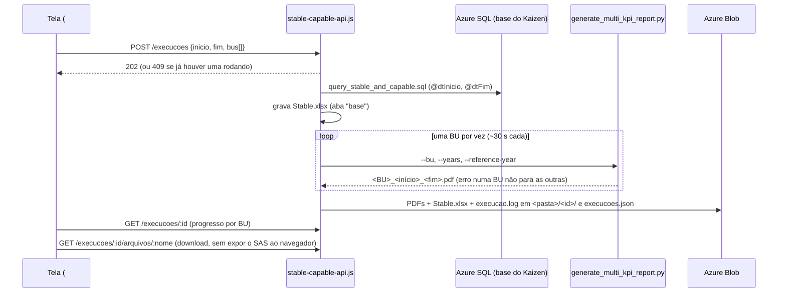

# VBM Stable & Capable

Estabilidade e capabilidade (SPC) dos KPIs operacionais. A aplicação gera os relatórios PDF por
Business Unit, importa o PCI Master do mês e tem um dashboard que reproduz a página "Stable and
capable" do Power BI.

- **Endereço:** `/VBM-Stable-and-Capable/`
- **Código:** `VBM-Stable-and-Capable/`
- **Acesso:** regra do Portal (`IBP.USERS` com `CD_MATRICULA`)
- **Stack:**
  - servidor: Node/Express (`stable-capable-api.js`, `importar-dados.js`, `bi-api.js`);
  - Python como processo filho (pandas, plotly + kaleido, reportlab, scipy, openpyxl);
  - tela: HTML/JS com SVG próprio, sem biblioteca de gráficos.
- **Documento da pasta:** `README.md`

## Opções da tela

`index.html`: uma página com quatro vistas pelo hash. A barra `setup-dashboards` e o estilo seguem
o Hub e o Kaizen.

| Vista | O que faz |
|---|---|
| `#inicio` | escolha entre as opções |
| `#modelo` | Rodar o modelo: gera os PDFs de SPC por BU |
| `#importar` | Importar dados: PCI Master → `IBP.PEDRAVISAODIARIA` |
| `#powerbi` | Dashboard: a página do `.pbix` refeita no app |

## Rodar o modelo (PDFs)

- **Período padrão** ("Fechamento mensal"): de 1º de janeiro do ano anterior ao último dia do mês
  anterior. Aceita intervalos de até 10 anos.
- **A consulta é a do time, como foi entregue:** `database/query_stable_and_capable.sql`. As datas do
  `WHERE` são trocadas por `@dtInicio` e `@dtFim`. Para mudar KPIs ou sites, edite o script.
- **Gerador:** `python/scripts/generate_multi_kpi_report.py` usa:
  - `src/report/`: `data_processor`, `chart_generator`, `page_composer`, `pdf_compiler`, `report_builder`;
  - `src/spc_functions.py`;
  - `config/report_config.yaml`: página de 452×254 mm;
  - `data/kpi_list.xlsx`: ordem e filtro dos KPIs por BU;
  - `data/images/cover_template.png`.
- **Execução:**
  - uma por vez (a segunda recebe 409);
  - pode ser cancelada (`POST /execucoes/:id/cancelar`);
  - status final `concluida`, `concluida-com-erros`, `erro` (nenhuma BU gerada) ou `cancelada`.
- **Histórico:** fica em `execucoes.json` no Blob, porque o SAS atual não tem permissão de listar.

## Importar dados (PCI Master)

Substitui o fluxo manual mensal (rodar `mapeamento.py` no Colab e subir o `resultado.xlsx`).

1. **Prévia:** `POST /importacao/previa` recebe o arquivo e o mês/ano, e roda
   `python/scripts/importar_pci_master.py` com `python/data/mapeamento_bu_kpi.xlsx`. **Nada é gravado.**
   A resposta mostra:
   - as linhas geradas;
   - os campos sem dados ou com dias faltando;
   - quantas linhas já existem no banco.
2. **Gravação:** `POST /importacao/previa/:id/confirmar {modo}` grava numa transação única:
   - `atualizar`: nas linhas existentes, atualiza **só o `VL_REAL`**; as demais são inseridas;
   - `novos`: só insere.

   Nenhuma linha é apagada, então `VL_D30`, `VL_CS`, `VL_PD` e `VL_PROJ` de outra origem ficam intactos.
3. **Conferência prévia:** antes de gravar, a API confere as colunas da tabela em
   `INFORMATION_SCHEMA`. Coluna faltando, ou obrigatória sem valor, bloqueia a gravação.
4. **Arquivos e registro:** o PCI Master e o `resultado_AAAA-MM.xlsx` vão para o Blob, em
   `<pasta>/importacoes/<id>/`, e o registro vai para `importacoes.json`.

O mapeamento aceita dois formatos (`NM_TABELA`, ou `NM_ABA` + `NM_CAMPO`), além de `ID_SISTEMA`,
`ID_SITE`, `ID_OPERACAO`, `ID_KPI` e "Dividir por 100?". Para mudar, substitua o `.xlsx` (ele pode ser
baixado pela tela). O login precisa de `SELECT`, `INSERT` e `UPDATE` na tabela.

## Dashboard (`#powerbi`)

Reprodução da página "Stable and capable" do `Stable_and_Capable_3.pbix`, com **as mesmas medidas**
e sem depender de licença do Power BI.

- **Dados:** `bi-api.js` roda `database/query_powerbi_stable_and_capable.sql` (a tabela `base` do
  `.pbix`) **sempre na PRD**. O resultado, cerca de 80 mil linhas, fica em memória e é recarregado a
  cada `STABLECAPABLE_BI_CACHE_MIN` (60 min) ou pelo botão Atualizar (`POST /bi/atualizar`).
  `GET /bi/filtros` devolve as combinações BU/Site/KPI/Operação; `GET /bi/serie?id=` devolve a série de uma combinação.
- **Cálculos:** `assets/js/painel-spc.js`, no navegador, com a mesma lógica dos scripts Python do
  `.pbix`.
  - Carta de controle por trimestre ou ano: CL = média; UCL/LCL = CL ± 3·MR̄/1,128, LCL ≥ 0.
  - Regras de Nelson 1 a 4 (a regra 4 avalia só a sequência alternada que termina no fim do período,
    como no script).
  - Faixa dos melhores 30 dias de cada período.
  - Medidas por período: Mean, Best 30 Days, P75 e Budget, com zoom do eixo em mín./máx. ± 15% e a
    variação da média entre períodos.
  - Histograma por ano: 35 faixas comuns, curva normal e tabela Ano/Média/Desvio/CV/N.
- **Layout:** igual à página do `.pbix`. A carta fica em cima; embaixo, as medidas (com a caixa
  "Variação da média") e o histograma.
- **Filtros** no padrão do COO:
  - Business Unit › Site em duas colunas;
  - KPI;
  - Operação, que só aparece quando há mais de uma;
  - Visão (Trimestre/Ano);
  - Período;
  - interruptores Remover zeros e Remover outliers (média ± 3,5 desvios).

  Os padrões são os do `.pbix`: Salobo / Salobo / Ore Mined, sem remover nada.
- **Responsividade:**
  - o gráfico de barras se ajusta à largura, sem rolagem lateral;
  - a partir de 1600 px, a vista usa até `min(94vw, 2400px)` (3400 px a partir de 3000 px), e as
    alturas acompanham a janela;
  - ver a skill `ajuste-responsividade`.

## API (`/VBM-Stable-and-Capable/api`)

| Rota | O que faz |
|---|---|
| `GET /ping`, `GET /config`, `GET /diagnostico` | diagnóstico sem banco; BUs, período sugerido e estado; Python, bibliotecas e Blob |
| `GET` / `POST /execucoes`, `GET /execucoes/:id`, `POST /execucoes/:id/cancelar`, `GET /execucoes/:id/arquivos/:nome` | PDFs (`?inline=1` abre o PDF no navegador) |
| `GET /importacao/config`, `GET /importacao/mapeamento`, `POST /importacao/previa`, `GET /importacao/previa/:id/resultado`, `POST /importacao/previa/:id/confirmar`, `GET /importacao/historico`, `GET /importacao/historico/:id/arquivos/:nome` | importação |
| `GET /bi/filtros`, `GET /bi/serie`, `POST /bi/atualizar` | dashboard |

O `portal.js` bloqueia na pasta o que não é tela: `python/`, `database/` e os `.js` do servidor.

## Dados e arquivos

| O quê | Onde |
|---|---|
| PDFs e importação (leitura e gravação) | base do Kaizen (`STABLECAPABLE_AZURE_SQL_DATABASE` → `KAIZEN_AZURE_SQL_DATABASE`, hoje **DEV**) |
| Tabela da importação | `IBP.PEDRAVISAODIARIA` (`STABLECAPABLE_TABELA_IMPORTACAO`) |
| Dashboard | **PRD** (`STABLECAPABLE_BI_SQL_DATABASE`, `STABLECAPABLE_BI_SQL_SERVER`) |
| Arquivos | Azure Blob do Kaizen (`azure-blob.js` da pasta do Kaizen), em `<AZURE_STORAGE_CONTAINER>/01 - Imagens/Stable & Capable/` (`STABLECAPABLE_BLOB_PASTA`). Sem Blob, usa o disco local (`STABLECAPABLE_PASTA_LOCAL`), e os arquivos se perdem ao reiniciar |

## Python

- **Executável:** `STABLECAPABLE_PYTHON` força um caminho; senão, usa `python3` / `python`, resolvido
  para caminho absoluto.
- **Bibliotecas:** vêm do `requirements.txt` da raiz, instalado no deploy. Se não importarem, a
  aplicação instala `python/requirements.txt` com `pip --target` em `STABLECAPABLE_PYLIBS`, ou em
  `<pasta>/.pylibs`, ou no temp. Isso leva até 30 min na primeira vez.
- **Versões:** `kaleido==0.2.1` (build Linux com Chromium próprio) e `plotly<6`, porque o plotly 6
  abandona o kaleido 0.2.

## Variáveis

| Variável | Padrão |
|---|---|
| `STABLECAPABLE_AZURE_SQL_DATABASE` | a do Kaizen |
| `STABLECAPABLE_BI_SQL_DATABASE` / `_BI_SQL_SERVER` / `_BI_CACHE_MIN` | `BDIBPBMSA_PRD` / `AZURE_SQL_SERVER` / 60 |
| `STABLECAPABLE_TABELA_IMPORTACAO` | `IBP.PEDRAVISAODIARIA` |
| `STABLECAPABLE_BLOB_PASTA` | `01 - Imagens/Stable & Capable` |
| `STABLECAPABLE_PASTA_LOCAL`, `STABLECAPABLE_PYTHON`, `STABLECAPABLE_PYLIBS` | automáticos |

## Desenvolvimento e testes

- **Standalone:** `node server.js` na pasta.
- **Modo teste sem banco:** `STABLECAPABLE_EXCEL_TESTE=<Stable.xlsx> PORT=8018 node server.js`
  troca o banco por um Excel com a aba `base`, nas consultas da aplicação inteira (PDFs e Dashboard).
- **Conferência:** os valores do Dashboard foram conferidos contra os scripts Python do `.pbix` (CL
  trimestral, medidas, variação da média, histograma).
- Não há testes automatizados na pasta.

## Pontos de atenção

- PDFs e importação usam a base **DEV** enquanto o Kaizen estiver na pasta DEV.
- O histórico depende de JSON no Blob, porque o SAS não tem listar nem apagar.
- A primeira subida depois de um deploy pode instalar as bibliotecas Python (lenta).
